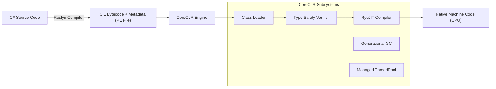

# Master of Science in Computer Science / Advanced Software Engineering

## Comprehensive .NET, CoreCLR & ASP.NET Core Syllabus Guide & Solutions Manual

**Instructor / Author:** .NET & ASP.NET Professor  
**Syllabus Coverage:** Units 1 through 4 + Master's Examination Solutions  
**Standard Reference:** [Microsoft Learn (.NET Documentation)](https://learn.microsoft.com/en-us/dotnet/)

---

## Pedagogical Structure

Every concept in this curriculum is presented in a rigorous 4-step framework:

1. **Definition & Architectural Concept**
2. **Simple & Direct Code Implementation**
3. **Workflow & Technical Explanation**
4. **Master's-Level In-Depth Insight** (CLR memory mechanics, IL emission, ASP.NET Core internals)

---

## Table of Contents

- [PART I: EXAM PAPER SOLUTIONS & ARCHITECTURAL FOUNDATIONS](#part-i-exam-paper-solutions)
  - [Question 1: Lambda Expression for Average](#question-1-lambda-expression-for-average)
  - [Question 2: Generic Delegates & Observer Pattern](#question-2-generic-delegates--observer-pattern)
  - [Question 3: LINQ Filtering & Deferred Execution](#question-3-linq-filtering--deferred-execution)
  - [Question 4: Method Overriding vs. Method Hiding](#question-4-method-overriding-vs-method-hiding)
  - [Question 5: .NET Platform & Multilingual Architecture](#question-5-net-platform--multilingual-architecture)
  - [Question 6: Core Runtime Fundamentals (Assemblies, CoreCLR, Extensions, Types)](#question-6-core-runtime-fundamentals)
  - [Exam Annotations: Memory Allocation & Garbage Collection](#exam-annotations-memory-allocation--garbage-collection)
- [PART II: FULL SYLLABUS CURRICULUM (UNITS 1 - 4)](#part-ii-full-syllabus-curriculum)
  - [UNIT 1: Overview of .NET, Origins & Goals](#unit-1-overview-of-net-origins--goals)
  - [UNIT 2: The Common Language Runtime (CLR) & Execution Model](#unit-2-the-common-language-runtime-clr--execution-model)
  - [UNIT 3: C# Language Deep Dive & Core Mechanics](#unit-3-c-language-deep-dive--core-mechanics)
  - [UNIT 4: ASP.NET Core MVC & Web Architecture](#unit-4-aspnet-core-mvc--web-architecture)

---

## PART I: EXAM PAPER SOLUTIONS

---

## Question 1: Lambda Expression for Average

### 1. Definition

A **lambda expression** is an anonymous function in C# used to create delegates or expression trees using the `=>` ("goes to") operator.

### 2. Code Implementation

```csharp
using System;
using System.Linq;

class Program
{
    static void Main()
    {
        int[] numbers = { 10, 20, 30, 40, 50 };

        // Lambda expression to calculate the average
        Func<int[], double> getAverage = arr => arr.Average();

        double avg = getAverage(numbers);
        Console.WriteLine($"Average: {avg}");
    }
}
```

### 3. Technical Explanation

- `Func<int[], double>` is a generic delegate representing a method taking an integer array parameter and returning a `double`.
- `arr => arr.Average()` invokes the LINQ extension method `.Average()` over the array.
- Prevents integer division truncation by calculating a floating-point average.

### 4. Master's-Level Insight

The Roslyn compiler generates a hidden `private static` method in the containing class and caches a singleton instance of the delegate, avoiding heap allocation overhead on repeated calls.

---

## Question 2: Generic Delegates & Observer Pattern

### 1. Definition

- **Generic Delegate:** A type-safe function pointer parameterized with type arguments (`TSender`, `TEventArgs`).
- **Multicast Delegate:** A delegate containing an internal invocation list (`_invocationList`) that executes multiple methods sequentially.

### 2. Code Implementation

```csharp
using System;

// 1. Generic Action delegate definition
public delegate void ActionDelegate<T1, T2>(T1 sender, T2 eventArgs);

// 2. Button class with required properties and delegate
public class Button
{
    public int Height, Weight, Colour, Size, Id;
    public string Text;

    // Delegate instance
    public ActionDelegate<Button, string> Click;

    public void OnClick(string eventArgs)
    {
        Click?.Invoke(this, eventArgs);
    }
}

// 3. Driver class
class Driver
{
    static void Main()
    {
        Button btn1 = new Button { Id = 101, Text = "Submit" };
        Button btn2 = new Button { Id = 102, Text = "Cancel" };

        // Multicasting the delegate
        ActionDelegate<Button, string> multiHandler = ClickHandle1;
        multiHandler += ClickHandle2;

        btn1.Click = multiHandler;
        btn2.Click = multiHandler;

        btn1.OnClick("MouseClick");
        btn2.OnClick("TouchTap");
    }

    static void ClickHandle1(Button sender, string e) => 
        Console.WriteLine($"[Handle 1] Triggered by Button ID: {sender.Id} (Event: {e})");

    static void ClickHandle2(Button sender, string e) => 
        Console.WriteLine($"[Handle 2] Triggered by Button ID: {sender.Id} (Event: {e})");
}
```

### 3. Pattern & Language Feature Identification

- **Pattern:** **Observer Pattern (Publish-Subscribe)**. The `Button` acts as the Publisher; `ClickHandle1` and `ClickHandle2` act as Observers.
- **Language Feature:** **C# Event / Delegation Model**.

---

## Question 3: LINQ Filtering & Deferred Execution

### 1. Definition

**Language Integrated Query (LINQ)** enables set-based declarative querying over in-memory collections with **deferred execution**.

### 2. Code Implementation

```csharp
using System;
using System.Collections.Generic;
using System.Linq;

class Student 
{ 
    public string FirstName { get; set; }
    public string LastName { get; set; }
    public int Age { get; set; }
}

class Program
{
    static void Main()
    {
        var students = new List<Student> {
            new Student { FirstName = "Sara", LastName = "Mills", Age = 24 },
            new Student { FirstName = "Andrew", LastName = "Gibson", Age = 21 },
            new Student { FirstName = "Craig", LastName = "Ellis", Age = 19 },
            new Student { FirstName = "Steven", LastName = "Cole", Age = 35 },
            new Student { FirstName = "Andrew", LastName = "Carter", Age = 15 }
        };

        // Filter students where age is between 18 and 24 (inclusive)
        var result = students.Where(s => s.Age >= 18 && s.Age <= 24);

        foreach (var s in result)
        {
            Console.WriteLine($"{s.FirstName} {s.LastName} {s.Age}");
        }
    }
}
```

### 3. Output

```text
Sara Mills 24
Andrew Gibson 21
Craig Ellis 19
```

---

## Question 4: Method Overriding vs. Method Hiding

### 1. Definition

- **Overriding (`virtual`/`override`):** Late binding (dynamic dispatch) based on the **runtime instance type** via the Virtual Method Table (`vtable`).
- **Hiding (`new`):** Early binding (static dispatch) based on the **compile-time reference type**.

### 2. Code Implementation

```csharp
using System;

public class Base 
{
    public virtual void Show() => Console.WriteLine("Base Virtual (Show)");
    public void Display() => Console.WriteLine("Base Normal (Display)");
}

public class Derived : Base 
{
    public override void Show() => Console.WriteLine("Derived Override (Show)");
    public new void Display() => Console.WriteLine("Derived Hiding (Display)");
}

class Program
{
    static void Main()
    {
        Base obj = new Derived();

        obj.Show();    // Outputs: Derived Override (Dynamic dispatch via vtable)
        obj.Display(); // Outputs: Base Normal     (Static dispatch via Reference Type)
    }
}
```

---

## Question 5: .NET Platform & Multilingual Architecture

1. **What is .NET?** A cross-platform, open-source development platform created by Microsoft featuring the **CoreCLR** runtime, **Base Class Library (BCL)**, and compilers.
2. **Applications Created with .NET:** Web (ASP.NET Core), Cloud (.NET Aspire, Docker), Desktop (.NET MAUI, WPF), Mobile (.NET MAUI), Gaming (Unity), AI (ML.NET), IoT.
3. **Why .NET is Multilingual:** Source code in C#, F#, or VB.NET compiles into **Common Intermediate Language (CIL/MSIL)** adhering to the **Common Type System (CTS)** and **Common Language Specification (CLS)**. The JIT compiler (`RyuJIT`) converts CIL into native machine code at runtime.

---

## Question 6: Core Runtime Fundamentals

- **6.A Assemblies vs. Namespaces:** An **Assembly** (`.dll`/`.exe`) is a *physical* binary unit of deployment and execution. A **Namespace** is a *logical* naming hierarchy for code organization.
- **6.B CoreCLR:** The modern execution engine providing JIT compilation (RyuJIT), generational Garbage Collection (GC), type safety, exception handling, and thread pooling.
- **6.C Extension Methods:** Static methods in static classes using the `this` keyword on the first parameter, compiled to static method invocations (`Class.Method(instance)`).
- **6.D Data Types in .NET:** All types derive from `System.Object`. Divided into **Value Types** (`System.ValueType`, stored inline/stack) and **Reference Types** (stored on managed heap).

---

## Exam Annotations: Memory Allocation & Garbage Collection

```text
   THREAD STACK (LIFO Execution)             MANAGED HEAP (GC Controlled)
+---------------------------------+       +-------------------------------------+
| int age = 25 (Inline Value)     |       | Person Object                       |
+---------------------------------+       | - SyncBlockIndex (8 bytes)          |
| Person p = 0x00007FFB34A12B80   |------>| - MethodTable Pointer (8 bytes)     |
| (Heap Memory Address Pointer)   |       | - string Name ("Sara Mills")        |
+---------------------------------+       +-------------------------------------+
```

1. **Generational Hypothesis:**
   - **Generation 0:** Short-lived objects. Cleaned frequently.
   - **Generation 1:** Buffer/survival zone.
   - **Generation 2:** Long-lived objects (Singletons, statics). Full GC.
   - **Large Object Heap (LOH):** Objects $\ge 85,000$ bytes allocated directly here.
2. **Mark-Sweep-Compact Algorithm:**
   - **Mark:** Traverses from GC roots to mark live objects.
   - **Sweep:** Reclaims unmarked memory.
   - **Compact:** Relocates surviving objects contiguously to eliminate fragmentation.

---

# PART II: FULL SYLLABUS CURRICULUM

---

# UNIT 1: Overview of .NET, Origins & Goals

---

## 1.1 Overview of .NET and Its Goals

### 1. Conceptual Definition

**.NET** is a modern, open-source, managed execution environment and software development platform engineered to solve the challenges of cross-platform portability, high runtime performance, memory safety, and developer productivity.

### 2. Core Architectural Goals

1. **Managed Execution & Memory Safety:** Eliminating manual memory deallocation (`malloc`/`free`) and dangling pointer errors through automatic Garbage Collection.
2. **Language Interoperability:** Enabling code written in multiple programming languages (C#, F#, Visual Basic) to seamlessly interoperate within the same application process.
3. **Cross-Platform Portability:** Running identical binaries on Linux, Windows, macOS, and mobile architectures (x86_64, ARM64).
4. **Unified Base Class Library (BCL):** Providing a single, consistent standard library for cryptography, file I/O, networking, collections, and reflection.

---

## 1.2 Origins of .NET and Enterprise Servers

### 1. The COM Era Problems & Genesis of .NET

In the late 1990s, Windows enterprise software relied heavily on **COM (Component Object Model)** and C/C++ / Visual Basic 6:

- **DLL Hell:** Conflicting dynamic-link library versions sharing global Windows registry keys caused system-wide application breakages.
- **Plumbing Overhead:** Developers spent significant time writing COM plumbing (`IUnknown`, `AddRef`, `Release`, `QueryInterface`, GUIDs) rather than business logic.
- **Lack of Memory Safety:** Buffer overflows and memory leaks were common in unmanaged code.

Microsoft initiated **Project Lightning (Next Generation Windows Services)**, which launched in 2002 as the **.NET Framework 1.0**, introducing managed code, the CLR, and C#.

### 2. Role of .NET Enterprise Servers

.NET Enterprise Servers (IIS, SQL Server, BizTalk, Exchange) integrated with the .NET runtime to deliver scalable enterprise solutions:

- **Internet Information Services (IIS):** Hosted ASP.NET web applications with process pooling and worker process recycling.
- **SQL Server CLR Integration:** Allowed developers to execute managed C# stored procedures and user-defined functions directly inside the database engine.
- **Enterprise Services (`System.EnterpriseServices`):** Distributed transactions (MSDTC) and role-based security.

---

## 1.3 .NET Framework vs. .NET Core vs. Modern .NET

```text
.NET Framework (2002-2019)           .NET Core (2016-2020)           .NET 5, 6, 7, 8, 9 (Modern .NET)
- Windows Only                       - Cross-Platform (Linux/Mac)    - Unified Single .NET Platform
- Monolithic Machine-Wide Install    - Side-by-Side Self-Contained   - High-Performance RyuJIT + PGO
- Tied to Windows OS Updates         - High Performance & Cloud First- Native AOT & WebAssembly
```

### Architectural Comparison

| Feature | .NET Framework (Legacy) | .NET Core (Modern Shift) | Modern .NET (.NET 8 / 9) |
| :--- | :--- | :--- | :--- |
| **Platform** | Windows Only | Windows, Linux, macOS | Universal Cross-Platform |
| **Open Source** | Closed / Reference Source | 100% Open Source (MIT) | 100% Open Source (MIT) |
| **Deployment** | Machine-wide GAC installation | Side-by-Side / App-local | Self-Contained / Single-File / Native AOT |
| **Performance** | Standard desktop/server speed | Redesigned lightweight pipeline | World-record TechEmpower benchmarks |
| **Web Stack** | ASP.NET (System.Web, IIS bound) | ASP.NET Core (Kestrel web server) | ASP.NET Core (Minimal APIs, Blazor) |

---

## UNIT 2: The Common Language Runtime (CLR) & Execution Model

---

## 2.1 Anatomy of a .NET Application

A .NET application is organized in a strict hierarchy:

```text
[ OS Process ]
   └── [ AppDomain / AssemblyLoadContext ]
          └── [ Assemblies (.dll, .exe) ]
                 └── [ Modules ]
                        └── [ Namespaces ]
                               └── [ Types (Classes, Structs, Enums, Interfaces) ]
                                      └── [ Members (Methods, Properties, Fields, Events) ]
```

- **AppDomain / AssemblyLoadContext:** Provides isolation boundaries for loading, executing, and unloading assemblies without restarting the host OS process.
- **Managed Assembly:** A portable executable (PE32/PE32+) file containing CIL bytecode, metadata tables, and the manifest.

---

## 2.2 Common Language Runtime (CLR / CoreCLR) Architecture

The CLR is the heart of the .NET execution engine.



### Core Subsystems

1. **Class Loader:** Resolves and loads referenced assemblies and types into memory on-demand.
2. **Type Safety Verifier:** Inspects CIL instructions to verify memory access safety before execution.
3. **JIT Compiler (`RyuJIT`):** Converts CPU-agnostic CIL instructions into native instructions (x86, x64, ARM64).
4. **Garbage Collector (GC):** Manages the allocation and reclamation of heap memory.
5. **Exception Engine:** Coordinates structured exception handling (SEH) with native stack unwinding.

---

## 2.3 Common Type System (CTS) & Common Language Specification (CLS)

- **Common Type System (CTS):** Defines the formal rules for all types supported by the CLR. It dictates how classes, interfaces, value types, and delegates are constructed and behave across all languages.
- **Common Language Specification (CLS):** A contractual subset of CTS rules that guarantees language interoperability.
  - *Example:* Unsigned integers (`uint`, `ulong`) are not CLS-compliant because some languages (like VB.NET historically) did not support them. A library using `int` (signed 32-bit) in public APIs is fully CLS-compliant.

---

## 2.4 Metadata, Type Tables & Manifests

Every compiled .NET assembly contains rich **Metadata**:

1. **Type Definition Table (`TypeDef`):** Describes classes, structs, properties, methods, and visibility declared in the assembly.
2. **Type Reference Table (`TypeRef`):** Records external types imported from other assemblies.
3. **Assembly Manifest:** Contains assembly identity (Name, Version, Culture, PublicKeyToken), file hashes, and dependency references.

> **Master's Note:** Metadata eliminates the need for header files (`.h`), IDL (Interface Definition Language), or COM type libraries (`.tlb`).

---

## 2.5 Managed Data, Garbage Collection & Memory Lifecycle

### 1. Concept: Managed vs. Unmanaged Data

- **Managed Data:** Memory allocated on the Managed Heap governed by the Garbage Collector.
- **Unmanaged Data:** Memory allocated outside the CLR (e.g., native pointers via `Marshal.AllocHGlobal`, file descriptors, OS sockets). Must be cleaned up manually via `IDisposable`.

### 2. Code Implementation: The Dispose Pattern

```csharp
using System;
using System.IO;

public class ResourceHolder : IDisposable
{
    private FileStream _fileStream; // Managed resource holding native handle
    private bool _disposed = false;

    public ResourceHolder(string path)
    {
        _fileStream = new FileStream(path, FileMode.OpenOrCreate);
    }

    public void WriteData(byte[] data)
    {
        if (_disposed) throw new ObjectDisposedException(nameof(ResourceHolder));
        _fileStream.Write(data, 0, data.Length);
    }

    // Deterministic Cleanup
    public void Dispose()
    {
        if (!_disposed)
        {
            _fileStream?.Dispose();
            _disposed = true;
            GC.SuppressFinalize(this); // Prevents finalizer queue overhead
        }
    }
}
```

---

## 2.6 Compiling, Organizing & Executing Managed Code

The two-stage compilation lifecycle:

1. **Stage 1 (Design/Build Time):**
   - C# Source files (`.cs`) $\xrightarrow{\text{Roslyn Compiler}}$ Managed Assembly containing CIL + Metadata (`.dll`).
2. **Stage 2 (Runtime Execution):**
   - The OS loads CoreCLR.
   - CoreCLR's class loader loads the entry assembly.
   - When a method is called for the first time, **RyuJIT** compiles the CIL method into native machine instructions and patches the method table pointer directly to the native code.
   - Subsequent calls execute native machine code directly at full hardware speed.

---

## 2.7 Comprehensive Comparison: .NET Core vs. .NET Framework

| Dimension | .NET Framework | .NET Core / .NET 8+ |
| :--- | :--- | :--- |
| **Host OS** | Windows only | Windows, Linux, macOS, Android, iOS |
| **Open Source** | No (Proprietary Microsoft runtime) | Yes (Active open-source community on GitHub) |
| **Web Technology** | ASP.NET WebForms / MVC 5 (System.Web) | ASP.NET Core (Kestrel server, pipeline architecture) |
| **CLI Toolchain** | MSBuild / Visual Studio GUI | Modern command-line interface (`dotnet new`, `dotnet run`) |
| **Microservices / Containers** | Heavy Windows Server containers | Ultra-lightweight Alpine Linux Docker containers |
| **Performance Innovations** | Classic JIT | Tiered JIT, Dynamic PGO, `Span<T>`, Hardware Intrinsics |

---

# UNIT 3: C# Language Deep Dive & Core Mechanics

---

## 3.1 Anatomy of a C# Program & Console I/O

### 1. Code Implementation

```csharp
using System;

namespace AdvancedDotNet.Unit3
{
    class Program
    {
        static void Main(string[] args)
        {
            Console.Write("Enter your name: ");
            string name = Console.ReadLine();

            Console.Write("Enter your birth year: ");
            if (int.TryParse(Console.ReadLine(), out int birthYear))
            {
                int age = DateTime.Now.Year - birthYear;
                Console.WriteLine($"Hello, {name}! You are {age} years old.");
            }
            else
            {
                Console.WriteLine("Invalid year format.");
            }
        }
    }
}
```

### 2. Technical Explanation

- `using System;`: Imports types from the foundational `System` namespace.
- `int.TryParse(...)`: Defensive parsing pattern that avoids throwing costly `FormatException` when invalid inputs are provided.
- `$"Hello, {name}..."`: String interpolation (compiled into `string.Format` or `DefaultInterpolatedStringHandler` in modern C#).

---

## 3.2 Type System, Value vs. Reference Types, Nullable Types

### 1. Core Mechanics

- **Value Types (`struct`, `enum`, primitives):** Stored directly where allocated (stack or inside heap objects). Copied bit-by-bit on assignment.
- **Reference Types (`class`, `string`, arrays):** Stored on the managed heap. Variables contain references (memory addresses).
- **Nullable Value Types (`int?` / `Nullable<T>`):** Allows value types to represent an undefined state `null`.

### 2. Code Implementation

```csharp
using System;

class TypeSystemDemo
{
    static void Main()
    {
        // Value Type semantics (independent copies)
        int a = 10;
        int b = a;
        b = 20;
        Console.WriteLine($"a: {a}, b: {b}"); // a remains 10

        // Nullable Value Type
        int? optionalScore = null;
        int finalScore = optionalScore ?? 0; // Null-coalescing operator
        Console.WriteLine($"Final Score: {finalScore}"); // 0
    }
}
```

---

## 3.3 Program Control Statements & Modern Pattern Matching

### 1. Code Implementation

```csharp
using System;

class PatternMatchingDemo
{
    public static string EvaluateGrade(object input) => input switch
    {
        int score when score >= 90 => "A Grade",
        int score when score >= 75 => "B Grade",
        int score when score >= 50 => "Pass",
        int => "Fail",
        string s when s.Equals("Absent", StringComparison.OrdinalIgnoreCase) => "Not Evaluated",
        null => "Missing Data",
        _ => "Unknown Input Type"
    };

    static void Main()
    {
        Console.WriteLine(EvaluateGrade(92));       // A Grade
        Console.WriteLine(EvaluateGrade("Absent"));   // Not Evaluated
        Console.WriteLine(EvaluateGrade(null));       // Missing Data
    }
}
```

### 2. Technical Explanation

- Uses the **C# Switch Expression** and **Type Pattern Matching** (`int score when ...`) introduced in modern C# to express complex conditional branching cleanly.

---

## 3.4 Arrays and Strings (Memory Layout & Interning)

### 1. String Immutability & String Interning

Strings in .NET are **immutable** reference types. Once a `System.String` object is created on the heap, its character buffer cannot be modified. Any modification creates a new string instance.

To optimize memory, the CLR maintains a table called the **Intern Pool**: identical string literals declared in source code point to the exact same heap memory address.

### 2. Code Implementation

```csharp
using System;
using System.Text;

class StringMemoryDemo
{
    static void Main()
    {
        // 1. String Interning Demonstration
        string s1 = "DotNetCore";
        string s2 = "DotNetCore";
        Console.WriteLine(object.ReferenceEquals(s1, s2)); // True: Point to same Intern Pool address

        // 2. High-performance string manipulation using StringBuilder
        StringBuilder sb = new StringBuilder();
        for (int i = 0; i < 5; i++)
        {
            sb.Append(i).Append(" ");
        }
        Console.WriteLine(sb.ToString()); // 0 1 2 3 4
    }
}
```

---

## 3.5 Object-Oriented Programming (OOP) in C#

### 1. Four Pillars of OOP in C#

1. **Encapsulation:** Protecting internal state via properties and access modifiers (`private`, `protected`, `public`, `internal`).
2. **Inheritance:** Deriving new classes from a base class (`class Derived : Base`).
3. **Polymorphism:** Performing different actions based on runtime type via `virtual` / `override` or interfaces.
4. **Abstraction:** Hiding implementation details using `abstract` classes and `interface` contracts.

### 2. Code Implementation

```csharp
using System;

// Abstraction: Interface Contract
public interface IShape
{
    double CalculateArea();
}

// Base Class demonstrating encapsulation
public abstract class Shape : IShape
{
    public string Name { get; }

    protected Shape(string name) => Name = name;

    // Abstract method must be implemented by derived classes
    public abstract double CalculateArea();
}

// Inheritance & Polymorphism
public class Circle : Shape
{
    public double Radius { get; set; }

    public Circle(double radius) : base("Circle")
    {
        Radius = radius;
    }

    public override double CalculateArea() => Math.PI * Radius * Radius;
}

public class Rectangle : Shape
{
    public double Width { get; set; }
    public double Height { get; set; }

    public Rectangle(double width, double height) : base("Rectangle")
    {
        Width = width;
        Height = height;
    }

    public override double CalculateArea() => Width * Height;
}

class Program
{
    static void Main()
    {
        IShape[] shapes = { new Circle(5), new Rectangle(4, 6) };

        foreach (var s in shapes)
        {
            Console.WriteLine($"Area: {s.CalculateArea():F2}");
        }
    }
}
```

---

## 3.6 Exception Handling & Custom Exceptions

### 1. Code Implementation

```csharp
using System;

// Custom Exception Definition
public class InsufficientFundsException : Exception
{
    public decimal CurrentBalance { get; }
    public decimal AttemptedAmount { get; }

    public InsufficientFundsException(decimal balance, decimal amount)
        : base($"Cannot withdraw {amount:C}. Available balance is {balance:C}.")
    {
        CurrentBalance = balance;
        AttemptedAmount = amount;
    }
}

public class BankAccount
{
    public decimal Balance { get; private set; } = 100m;

    public void Withdraw(decimal amount)
    {
        if (amount > Balance)
            throw new InsufficientFundsException(Balance, amount);

        Balance -= amount;
    }
}

class Program
{
    static void Main()
    {
        BankAccount account = new BankAccount();

        try
        {
            account.Withdraw(250m);
        }
        catch (InsufficientFundsException ex)
        {
            Console.WriteLine($"[Custom Exception Caught]: {ex.Message}");
        }
        catch (Exception ex)
        {
            Console.WriteLine($"[General Exception]: {ex.Message}");
        }
        finally
        {
            Console.WriteLine("Transaction audit complete.");
        }
    }
}
```

---

## 3.7 Delegates, Action, Func & Predicate

### 1. Concept: Built-in Generic Delegates

Instead of declaring custom delegate types, .NET provides standard functional generic delegates in `System`:

- `Action<T1, T2...>`: Encapsulates a method returning `void`.
- `Func<T1, T2..., TResult>`: Encapsulates a method returning a value of type `TResult`.
- `Predicate<T>`: Encapsulates a method testing an object and returning a `bool`.

### 2. Code Implementation

```csharp
using System;

class BuiltInDelegatesDemo
{
    static void Main()
    {
        // 1. Action: Returns void
        Action<string> printLog = msg => Console.WriteLine($"[LOG]: {msg}");
        printLog("System initialized.");

        // 2. Func: Takes inputs, returns result
        Func<int, int, int> add = (x, y) => x + y;
        Console.WriteLine($"Sum: {add(15, 25)}");

        // 3. Predicate: Takes input, returns bool
        Predicate<int> isEven = n => n % 2 == 0;
        Console.WriteLine($"Is 10 even? {isEven(10)}");
    }
}
```

---

## 3.8 Language Integrated Query (LINQ)

### 1. Standard LINQ Operators

```csharp
using System;
using System.Collections.Generic;
using System.Linq;

class LinqOperatorsDemo
{
    static void Main()
    {
        var numbers = new List<int> { 5, 12, 8, 20, 3, 15, 8 };

        // Filtering, Ordering, Transformation and Aggregation
        var processed = numbers
            .Where(n => n > 5)         // Filter: 12, 8, 20, 15, 8
            .OrderBy(n => n)           // Sort: 8, 8, 12, 15, 20
            .Distinct()                // Unique: 8, 12, 15, 20
            .Select(n => $"Value: {n}") // Project to string
            .ToList();

        processed.ForEach(Console.WriteLine);
    }
}
```

---

## 3.9 Advanced C# Features: Generics, Extension Methods & Records

### 1. Code Implementation

```csharp
using System;

// 1. Immutable Data Record (Value-based equality)
public record Product(int Id, string Name, decimal Price);

// 2. Generic Repository Pattern
public class GenericRepository<T>
{
    private T _entity;
    public void Store(T entity) => _entity = entity;
    public T Retrieve() => _entity;
}

// 3. Extension Method
public static class MathExtensions
{
    public static decimal ApplyDiscount(this decimal price, decimal percentage) =>
        price - (price * (percentage / 100m));
}

class Program
{
    static void Main()
    {
        Product p1 = new Product(1, "Laptop", 1000m);
        Product p2 = new Product(1, "Laptop", 1000m);

        // Record Value Equality
        Console.WriteLine($"Record Equality: {p1 == p2}"); // True!

        // Extension method invocation
        decimal discounted = p1.Price.ApplyDiscount(15m);
        Console.WriteLine($"Discounted Price: ${discounted}"); // $850.00
    }
}
```

---

## UNIT 4: ASP.NET Core MVC & Web Architecture

---

## 4.1 Fundamentals of MVC (Model-View-Controller) Architecture

```text
[ Browser Client ]
       │
       ▼ (HTTP GET /courses)
[ Controller ] ◄─────── Coordinates Flow ────────► [ Model ] (Data & Logic)
       │                                                 │
       ▼ (Passes ViewModels)                             │
   [ View ] (Renders HTML / Razor Engine)                │
       │                                                 │
       ▼                                                 │
[ Rendered HTML Response ] ──────────────────────────────┘
```

- **Model:** Represents business domain data, database entities (EF Core), and validation rules.
- **View:** Razor template (`.cshtml`) that transforms model data into HTML for the client.
- **Controller:** Inherits from `Microsoft.AspNetCore.Mvc.Controller`, processes incoming HTTP requests, queries services/models, and selects the View to render.

### 2. Code Implementation: Basic Controller & Model

```csharp
// Models/Course.cs
public class Course
{
    public int Id { get; set; }
    public string Title { get; set; }
    public decimal Price { get; set; }
}

// Controllers/CourseController.cs
using Microsoft.AspNetCore.Mvc;
using System.Collections.Generic;

public class CourseController : Controller
{
    public IActionResult Index()
    {
        var courses = new List<Course>
        {
            new Course { Id = 1, Title = "ASP.NET Core Architecture", Price = 99.99m },
            new Course { Id = 2, Title = "Advanced C# CLR Internals", Price = 89.99m }
        };

        // Passes model data directly to Views/Course/Index.cshtml
        return View(courses);
    }
}
```

---

## 4.2 Dependency Injection (DI) & Service Lifetimes

### 1. Definition

**Dependency Injection (DI)** is a first-class architectural pattern built directly into ASP.NET Core to achieve Inversion of Control (IoC).

### 2. The Three Service Lifetimes

| Lifetime | Registration Method | Instantiation Rule | Ideal Use Case |
| :--- | :--- | :--- | :--- |
| **Transient** | `builder.Services.AddTransient<TInterface, TImpl>()` | A new instance is created **every single time** it is requested. | Lightweight, stateless services. |
| **Scoped** | `builder.Services.AddScoped<TInterface, TImpl>()` | Created **once per HTTP Request lifecycle** and shared across that request. | Entity Framework Database Context (`DbContext`), Unit of Work. |
| **Singleton** | `builder.Services.AddSingleton<TInterface, TImpl>()` | Created **once on initial request** and shared across the entire application lifetime. | In-memory cache, background workers, logging configuration. |

### 3. Code Implementation: DI Registration & Injection

```csharp
// 1. Service Interface & Implementation
public interface IGreetingService
{
    string GetGreeting();
}

public class GreetingService : IGreetingService
{
    public string GetGreeting() => "Welcome to Master's ASP.NET Core Course!";
}

// 2. Registration in Program.cs (ASP.NET Core 8/9 Minimal Hosting)
var builder = WebApplication.CreateBuilder(args);

// Register with Scoped lifetime
builder.Services.AddScoped<IGreetingService, GreetingService>();
builder.Services.AddControllersWithViews();

var app = builder.Build();

// 3. Constructor Injection into Controller
public class HomeController : Controller
{
    private readonly IGreetingService _greetingService;

    // Dependency is injected automatically by ASP.NET Core IoC container
    public HomeController(IGreetingService greetingService)
    {
        _greetingService = greetingService;
    }

    public IActionResult Index()
    {
        ViewBag.Message = _greetingService.GetGreeting();
        return View();
    }
}
```

---

## 4.3 ASP.NET Core Middleware Pipeline

### 1. Definition

**Middleware** is software assembled into an application pipeline to handle HTTP requests and responses. Each component:

1. Chooses whether to pass the request to the next component in the pipeline.
2. Can perform work before and after the next component is invoked.

```text
HTTP Request ──► [ Middleware 1 (Logging) ]
                    └──► [ Middleware 2 (Auth) ]
                            └──► [ Middleware 3 (Endpoint/MVC) ]
                                      │
HTTP Response ◄── [ Middleware 1 ] ◄──┘
```

### 2. Code Implementation: Custom Middleware

```csharp
using Microsoft.AspNetCore.Http;
using System.Diagnostics;
using System.Threading.Tasks;

// Custom Performance Monitoring Middleware
public class PerformanceMiddleware
{
    private readonly RequestDelegate _next;

    public PerformanceMiddleware(RequestDelegate next)
    {
        _next = next;
    }

    public async Task InvokeAsync(HttpContext context)
    {
        var timer = Stopwatch.StartNew();

        // 1. Logic executed BEFORE next middleware
        await _next(context);

        // 2. Logic executed AFTER next middleware on response return
        timer.Stop();
        context.Response.Headers["X-Execution-Time-Ms"] = timer.ElapsedMilliseconds.ToString();
    }
}

// Extension method for clean registration
public static class MiddlewareExtensions
{
    public static IApplicationBuilder UsePerformanceMonitor(this IApplicationBuilder app) =>
        app.UseMiddleware<PerformanceMiddleware>();
}
```

---

## 4.4 Routing in ASP.NET Core: Conventional vs. Attribute Routing

### 1. Conventional Routing

Defined globally in `Program.cs`. Matches URLs based on URI template patterns (`{controller=Home}/{action=Index}/{id?}`).

```csharp
app.MapControllerRoute(
    name: "default",
    pattern: "{controller=Home}/{action=Index}/{id?}");
```

### 2. Attribute Routing

Defined directly on Controllers and Action methods using attributes. Highly recommended for RESTful APIs.

```csharp
using Microsoft.AspNetCore.Mvc;

[ApiController]
[Route("api/[controller]")]
public class StudentsController : ControllerBase
{
    // Matches: GET /api/students/25
    [HttpGet("{id:int}")]
    public IActionResult GetById(int id)
    {
        return Ok(new { StudentId = id, Name = "Sara Mills" });
    }

    // Matches: POST /api/students
    [HttpPost]
    public IActionResult Create([FromBody] Student student)
    {
        return CreatedAtAction(nameof(GetById), new { id = 101 }, student);
    }
}
```

---

## 4.5 Model Binding, Data Annotations & Validation

### 1. Definition

- **Model Binding:** The automated process of extracting data from HTTP requests (route data, query strings, form fields, JSON body) and converting them into strongly typed C# objects.
- **Model Validation:** Verifying that incoming data satisfies business validation constraints using `System.ComponentModel.DataAnnotations`.

### 2. Code Implementation

```csharp
using System.ComponentModel.DataAnnotations;
using Microsoft.AspNetCore.Mvc;

// Model with Validation Rules
public class RegisterViewModel
{
    [Required(ErrorMessage = "Full Name is required.")]
    [StringLength(50, MinimumLength = 3)]
    public string FullName { get; set; }

    [Required]
    [EmailAddress(ErrorMessage = "Invalid Email Address.")]
    public string Email { get; set; }

    [Range(18, 100, ErrorMessage = "Age must be at least 18.")]
    public int Age { get; set; }
}

// Controller processing submission
public class AccountController : Controller
{
    [HttpPost]
    public IActionResult Register(RegisterViewModel model)
    {
        // Check if data satisfies Data Annotations
        if (!ModelState.IsValid)
        {
            // Return back to form showing validation errors
            return View(model);
        }

        // Process valid registration
        return RedirectToAction("Welcome");
    }
}
```

---

## 4.6 Tag Helpers in ASP.NET Core MVC

### 1. Definition

**Tag Helpers** enable server-side C# code to participate in creating and rendering HTML elements in Razor files. They provide a modern, HTML-friendly syntax compared to legacy Razor HTML Helpers (`@Html.TextBoxFor(...)`).

### 2. Common Built-In Tag Helpers (`.cshtml`)

```html
<!-- Form Tag Helper: Generates form action URL and anti-forgery token -->
<form asp-controller="Account" asp-action="Register" method="post">
    <div>
        <label asp-for="FullName"></label>
        <input asp-for="FullName" class="form-control" />
        <span asp-validation-for="FullName" class="text-danger"></span>
    </div>

    <div>
        <label asp-for="Email"></label>
        <input asp-for="Email" class="form-control" />
        <span asp-validation-for="Email" class="text-danger"></span>
    </div>

    <!-- Anchor Tag Helper: Generates href="/Account/Login" -->
    <a asp-controller="Account" asp-action="Login">Already registered? Log in</a>

    <button type="submit" class="btn btn-primary">Submit</button>
</form>
```

### 3. Creating a Custom Tag Helper (Master's Level)

```csharp
using Microsoft.AspNetCore.Razor.TagHelpers;

// Creates a custom <alert type="warning">Message</alert> element
[HtmlTargetElement("alert")]
public class AlertTagHelper : TagHelper
{
    public string Type { get; set; } = "info"; // Attribute: type="danger|success|warning"

    public override void Process(TagHelperContext context, TagHelperOutput output)
    {
        output.TagName = "div";
        output.Attributes.SetAttribute("class", $"alert alert-{Type} shadow-sm");
        output.Attributes.SetAttribute("role", "alert");
    }
}
```

---

## Summary & Quick Exam Review Checklist

| Unit | Core Topics to Master |
| :--- | :--- |
| **Unit 1** | .NET Goals, COM problems (DLL Hell), .NET Framework vs .NET Core vs .NET 8/9. |
| **Unit 2** | CLR subsystems, CTS vs CLS, Metadata, CIL Compilation, Generational GC, Assemblies. |
| **Unit 3** | Value vs Reference Types, Pattern Matching, OOP Pillars, `virtual`/`override` vs `new`, Delegates & Events, LINQ, Extension Methods. |
| **Unit 4** | MVC Architecture, Dependency Injection Lifetimes (Transient, Scoped, Singleton), Middleware Pipeline, Routing, Model Binding & Tag Helpers. |

---
*Created and verified for the Master of Science Curriculum in Advanced Software Engineering & .NET Core Runtime Architecture.*
InfoDesk Product Support Intern — Master Interview Preparation Guide

1. Company & Role Intelligence: Deconstructing InfoDesk
Who is InfoDesk?
Domain: Enterprise Intelligence SaaS and Intelligence Activation.
The Core Problem They Solve: Large enterprises (especially in regulated industries like Life Sciences, Pharma, Healthcare, and Financial Compliance) are flooded with massive streams of information (regulatory updates, scientific literature, clinical trials, competitive intel). InfoDesk filters, structures, validates, and embeds decision-ready insights directly into enterprise workflows.
Founded: 1999 (25+ years of domain authority).
What Does a Product Support Intern Actually Do at InfoDesk?
In B2B Enterprise SaaS, Support is not basic call-center customer service. You are the bridge between high-value enterprise users, Product Managers, and Software Engineers. Your day-to-day involves:

Triage & Diagnosis: Reproducing issues reported by clients, inspecting browser network requests, API responses, user permissions, and configuration.
Root-Cause Isolation: Determining if an issue is a User Error / Configuration issue, a Data / Feed issue, an API / Backend bug, or an Infrastructure outage.
Escalation & Collaboration: Creating detailed bug tickets for engineering with reproducible steps, payloads, and logs.
Knowledge Management: Writing Knowledge Base (KB) articles, FAQs, and release validation notes.
2. Your Project Breakdown: How to Pitch Your Real Work
You have built powerful full-stack and data-driven systems. Here is how to present them as enterprise SaaS products you understand inside-out:

┌────────────────────────────────────────────────────────────────────────┐
│                        YOUR PROJECT PORTFOLIO                          │
├─────────────────────────────────────────┬──────────────────────────────┤
│  1. SkillHub (Enterprise EdTech SaaS)   │  2. InsightX (Intelligence)  │
│  - ASP.NET Core Clean Architecture API  │  - FastAPI & Python Engine   │
│  - Angular 21 Standalone & Signals UI   │  - Automated Data Cleaning   │
│  - JWT Auth, RBAC, EF Core, SQL Server  │  - Decision Analytics Engine │
└─────────────────────────────────────────┴──────────────────────────────┘
Project 1: SkillHub (Enterprise SaaS Platform)
Tech Stack: ASP.NET Core Web API (Clean Architecture: API, Application, Domain, Infrastructure), Entity Framework Core, SQL Server, Angular 21 (Signals, Standalone Components, Reactive Forms), JWT & RBAC.
How to frame it for Support:
"I built SkillHub as a multi-role enterprise SaaS platform with distinct Admin, Instructor, and Student portals. Because I implemented the end-to-end authentication, role-based access control (RBAC), course curriculum engine, and payment workflows, I understand exactly how permissions, token expiration, HTTP 401/403 authorization failures, and API payload mismatches occur in production SaaS systems."

Project 2: InsightX (Data & Intelligence Analytics Engine)
Tech Stack: Python / FastAPI, Pandas, NumPy, automated column detection, data sanitization pipelines, and modular analytics engines.
Why this is a Goldmine for InfoDesk: InfoDesk is an intelligence activation platform. InsightX takes unstructured/raw data feeds, detects schema types, sanitizes NaN/null edge cases, and transforms raw data into decision metrics.
How to frame it for Support:
"In InsightX, I engineered data ingestion pipelines that automatically clean, map, and aggregate complex datasets. I handled edge cases like null/infinite values corrupting JSON serialization, API payload validation, and data anomalies. This gives me direct insight into the data intelligence workflows and feed troubleshooting that InfoDesk delivers to enterprise clients."

1. The 5-Step Enterprise Support Troubleshooting Framework
When the interviewer asks: "How do you troubleshoot a reported issue?", use this systematic framework:

mermaid
flowchart LR
    Step1["1. Acknowledge & Clarify"] --> Step2["2. Replicate & Gather Data"]
    Step2 --> Step3["3. Isolate Layer (UI/API/DB)"]
    Step3 --> Step4["4. Resolve or Escalate (Jira)"]
    Step4 --> Step5["5. Document (KB / FAQ)"]
Step 1: Acknowledge & Clarify
Acknowledge the user promptly with empathy.
Clarify specifics: User ID/Email, Tenant/Organization, exact URL, steps taken, expected vs. actual result, timestamp, and browser/OS.
Step 2: Replicate & Gather Evidence
Attempt to reproduce the issue in a staging/sandbox environment with identical role permissions.
Request/Inspect:
Browser DevTools Console: JavaScript runtime errors.
Network Tab / HAR file: Failed network requests, response payloads, latency.
Screenshots / Screen recordings.
Step 3: Isolate the Failure Domain
Use the HTTP Status Code triage model:

Status Code Failure Domain What You Check / Do
400 Bad Request Request Payload / Client Validate request schema, missing required fields, malformed JSON.
401 Unauthorized Authentication Expired JWT token, missing Bearer header, session timeout.
403 Forbidden Authorization / RBAC User lacks required role/permission for that tenant or resource.
404 Not Found Routing / Resource Invalid endpoint, deleted resource ID, route mismatch.
429 Too Many Requests Rate Limiting User/Script hitting API rate limits.
500 Internal Server Error Backend / Application Bug Unhandled exception, null pointer, database connectivity issue $\rightarrow$ Check backend server logs.
504 Gateway Timeout Infrastructure / Proxy Slow database query, downstream microservice timeout, heavy aggregation.
Step 4: Resolve or Escalate
If Configuration / User Error: Guide the user with clear, numbered, step-by-step instructions and screenshots.
If Bug: Create a high-quality Engineering ticket (Jira) containing:
Summary & Severity/Priority level.
Environment & Tenant details.
Exact Steps to Reproduce (STR).
Expected vs. Actual behavior.
Network logs, API Request/Response payloads, and stack traces.
Step 5: Document & Prevent
Write or update an internal Knowledge Base (KB) article or client-facing FAQ so the team can resolve it faster next time.
4. Top Interview Questions & Model Answers
Q1: "Tell me about yourself and why you're interested in Product Support at InfoDesk."
Answer: "I am a Computer Science graduate / student with hands-on experience building full-stack web applications and data platforms. Through projects like SkillHub, an ASP.NET Core and Angular enterprise learning platform, and InsightX, a data intelligence and analytics engine, I've developed a strong technical foundation in REST APIs, authentication models, database relationships, and frontend-backend data flows.

While I enjoy coding, I am particularly energized by problem-solving, root-cause analysis, and understanding how end-users interact with software in high-stakes environments. InfoDesk stands out to me because you've pioneered Intelligence Activation for over 25 years in heavily regulated industries like Life Sciences. I want to bring my technical troubleshooting skills, curiosity, and customer-first mindset to help InfoDesk's global enterprise users succeed."

Q2: "A user submits a ticket saying: 'The export button is broken and nothing is happening.' How do you investigate?"
Answer:

Initial Assessment: I'd check the user's role and permissions, tenant configuration, and what data they are attempting to export.
Replication: I'd log in with similar permissions in a test environment and follow their exact steps.
Inspect the Client Side: I'd check Browser DevTools:
Is there a JavaScript error in the Console preventing the click handler from firing?
In the Network tab, did the click initiate an HTTP request?
Inspect the API & Response:
If no request fired $\rightarrow$ UI event binding issue or client-side validation block.
If request fired with 403 $\rightarrow$ User lacks export permissions.
If request returned 500 or timed out (504) $\rightarrow$ The backend query is failing or crashing due to large dataset volume.
Resolution: If it's a workaround (e.g., filtering a smaller date range), I provide immediate relief to the client while escalating the bug to Engineering with the exact payload and stack trace.
Q3: "How do you explain a technical issue to a non-technical client?"
Answer: "I use the A-E-R principle: Acknowledge, Explain with analogies without jargon, and Provide the Next Action.

For example, instead of saying: 'Your JWT Bearer token expired causing a 401 Unauthorized on the REST endpoint,' I would say: 'For your account's security, your login session automatically refreshes after a period of inactivity. It looks like your session expired, which prevented the page from saving your changes. If you simply refresh the page and log back in, you will be able to proceed immediately. I am also here if you need any assistance.'"

Q4: "How do you prioritize multiple urgent support tickets?"
Answer: "I evaluate tickets based on Impact (how many users/tenants are affected) and Urgency (critical business workflows blocked):

P1 / Critical: System down, data loss, security vulnerability, or core workflow completely blocked for an entire enterprise organization. (Requires immediate triage, customer communication, and engineering escalation).
P2 / High: Major feature broken with no immediate workaround, affecting multiple users.
P3 / Medium: Issue affecting a single user with a viable workaround.
P4 / Low: Cosmetic UI bugs, minor typos, or general feature requests. I ensure all clients receive prompt acknowledgment while dedicating primary focus to high-impact blockers."
Q5: "What is the difference between an API bug and a Frontend bug?"
Answer: "A Frontend bug is an issue with the UI presentation, client-side routing, responsive styling, or DOM event handling (e.g., an Angular button click not triggering, or form validation showing false errors). The server might be perfectly healthy, but the browser is misbehaving.

An API bug occurs on the server side where the endpoint receives a valid request but returns an incorrect HTTP status (like 500 Internal Server Error), malformed JSON, corrupted data, or fails business logic. We differentiate between the two by inspecting the DevTools Network Tab: if the request payload sent by the UI is valid but the server response is faulty, it's an API bug."

1. Technical Cheat Sheet for Quick Revision
┌────────────────────────────────────────────────────────────────────────┐
│                    SUPPORT INTERVIEW CHEAT SHEET                       │
├───────────────────┬────────────────────────────────────────────────────┤
│ REST Methods      │ GET (read), POST (create), PUT/PATCH (update),     │
│                   │ DELETE (remove)                                    │
├───────────────────┼────────────────────────────────────────────────────┤
│ DevTools Tabs     │ Elements (DOM/CSS), Console (JS errors),           │
│                   │ Network (HTTP calls/timings), Application (Cookies,│
│                   │ LocalStorage, SessionTokens)                       │
├───────────────────┼────────────────────────────────────────────────────┤
│ SaaS Multi-Tenancy│ Multiple clients share the same infrastructure     │
│                   │ with strict data isolation per tenant/org.         │
├───────────────────┼────────────────────────────────────────────────────┤
│ SLA & Escalation  │ Service Level Agreement = Guaranteed response &    │
│                   │ resolution times based on issue severity.          │
└───────────────────┴────────────────────────────────────────────────────┘
2. High-Impact Questions to Ask the Interviewer at the End
When they ask, "Do you have any questions for us?", ask 2 or 3 of these to show deep preparation:

"How does the Product Support team collaborate with Engineering and Product Management at InfoDesk when new platform updates or AI intelligence features are rolled out?"
"What ticketing and diagnostic tools (like Zendesk, Jira, Postman, Datadog) does the support team rely on daily?"
"What distinguishes a good support intern from an exceptional one who successfully transitions into a full-time role at InfoDesk?"
